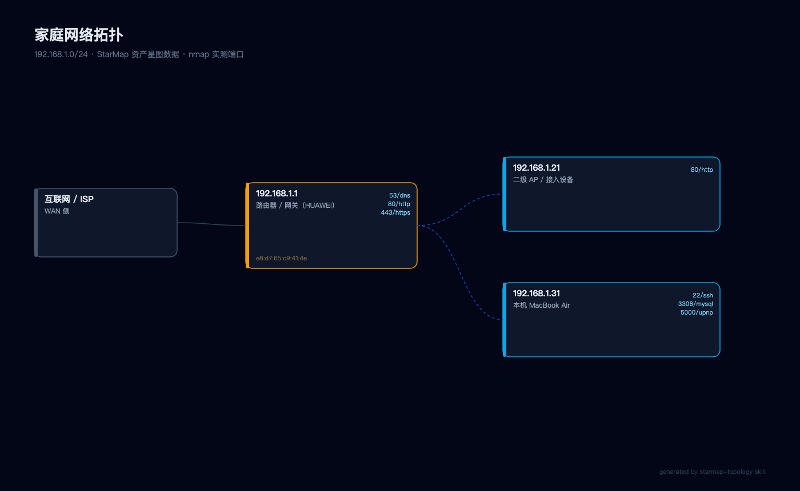
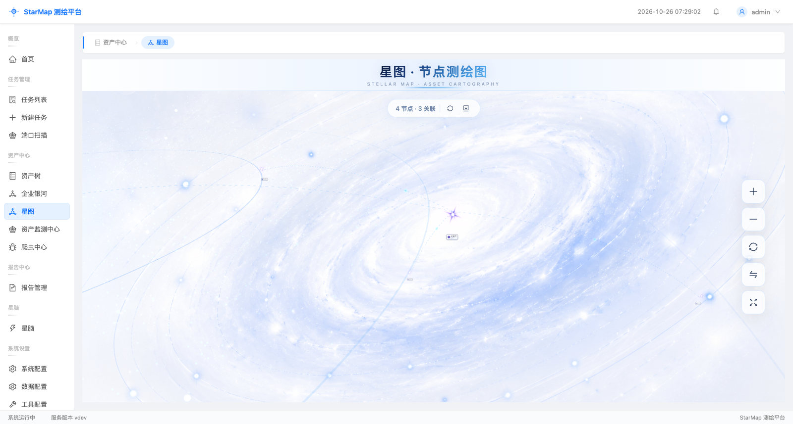

# starmap-topology

用 [StarMap（星图）](https://github.com/adminbugw/starmap) 给自己家里的网络做一次资产测绘，并画出一张可交付的**网络拓扑图**。

本仓库是一个 **DeepSeek Harness skill**：把「部署 StarMap → 发现资产 → 建资产星图 → 渲染拓扑 → 留档」固化下来，以后一句话就能复跑。

## 产出示例





## 它解决什么

- StarMap 只有 Linux/Windows 二进制 → macOS 上跑在 **arm64 Linux 虚拟机**（Parallels + Kali）
- Parallels 共享网络（NAT）下 StarMap 自带扫描器会漏报 → 提供 **宿主机 nmap 发现 + 回填资产库** 的模式
- StarMap 的 3D 星图需要 WebGL → 提供 headless Chrome 软件 WebGL 截图与无依赖 SVG 渲染两条出图路径

## 快速开始

```bash
# 1) 装到虚拟机
./scripts/install_starmap.sh user@10.211.55.43

# 2) 登录拿 cookie
python3 scripts/starmap_api.py login --base http://10.211.55.43:8080 --password <启动口令>

# 3) 发现 + 端口（宿主机，ARP 最准）
python3 scripts/scan_lan.py 192.168.1.0/24 > assets/topology.json

# 4) 渲染拓扑图
python3 scripts/render_topology.py assets/topology.json /tmp/topology.html
"/Applications/Google Chrome.app/Contents/MacOS/Google Chrome" \
  --headless=new --disable-gpu --no-sandbox --user-data-dir=/tmp/chrome-prof \
  --screenshot=assets/network-topology.png --window-size=1400,860 file:///tmp/topology.html
```

## 目录

| 路径 | 说明 |
|---|---|
| `SKILL.md` | 完整工作流（含合规门禁、坑位表） |
| `scripts/install_starmap.sh` | 下载 + 传输 + 启动 StarMap |
| `scripts/starmap_api.py` | StarMap API（登录/建任务/端口扫描/建图/截图） |
| `scripts/scan_lan.py` | nmap 发现 + 端口识别 → topology.json |
| `scripts/render_topology.py` | topology.json → 拓扑图（SVG→PNG） |
| `assets/` | 拓扑图、星图截图、图数据 |
| `references/` | API 速查与排错笔记 |

## 合规

仅用于本人或已书面授权网络的安全自查。禁止对未授权目标扫描、测绘或探测。
